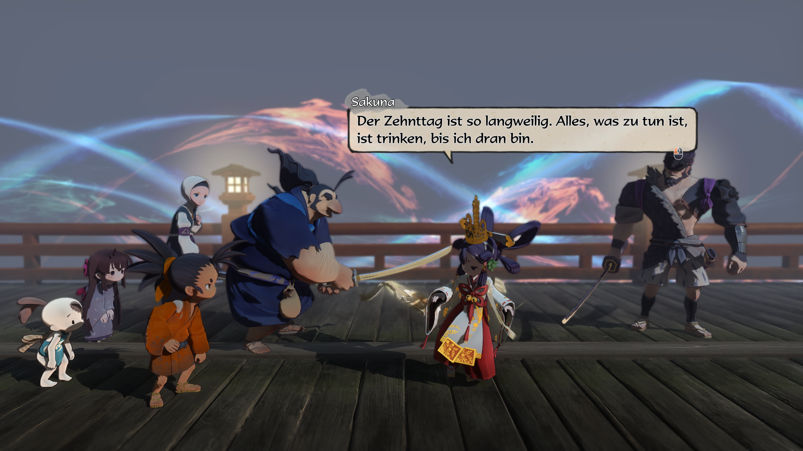

# SakunaDeutsch — Deutscher Sprachpatch für *Sakuna: Of Rice and Ruin*

> **Deutsch**  |  [English](README.md)

Komplette deutsche Übersetzung von *Sakuna: Of Rice and Ruin*. Das Spiel kennt
offiziell keine deutsche Sprache – dieser Patch schreibt das Deutsche in die
vorhandene **`Spanish`-Spalte** und schaltet das Spiel über **`"Language": "Sp"`**
um. Englisch bleibt unangetastet.

> **Kein Spielmaterial im Repository.** Hier liegen *nur* das Werkzeug und die
> deutschen Texttabellen. Die `.arc`-Archive werden **nicht mitgeliefert** – das
> Installations-Skript baut sie aus deiner **eigenen Spielspiegelung** (jeder
> braucht eine legitime Kopie des Spiels).

> **Unofficial / inoffiziell.** Kein offizielles Produkt, keine Verbindung zu
> Edelweiss, Marvelous oder XSEED Games.

---

## Für Spieler

### Voraussetzungen

- Eine installierte Kopie des Spiels (Steam, GOG; unter Linux/Proton ebenfalls)
- **Python 3.10+** — unter Windows auf [python.org](https://www.python.org/downloads/)
  herunterladen und beim Setup unbedingt **„Add Python to PATH"** ankreuzen;
  unter Linux z. B. `sudo apt install python3` (Distribution-Paket genügt)
- Beim ersten Start lädt das Skript automatisch das kleine Paket `lz4` nach
  (eine Internetverbindung genügt); Bauzeit insgesamt etwa 1–2 Minuten

### Installation — drei Schritte

**Windows:** Repository herunterladen (Code → Download ZIP), entpacken,
**`INSTALL.bat` doppelklicken**. Bestätigen (J).

**Linux / macOS:** Repository entpacken und im Terminal ausführen:

```bash
python3 install.py
```

Das Skript erledigt alles selbst:

1. **Findet das Spiel** (durchsucht die Steam-Bibliotheken inkl. Flatpak/Proton;
   nicht gefunden? siehe FAQ)
2. **Installiert fehlende Python-Abhängigkeiten** (`lz4` via pip)
3. **Legt Backups an**: `dataWin/Text.arc.bak-original` bzw.
   `Common.arc.bak-original` — ein einziges Mal, danach nie wieder überschrieben
4. **Baut den Patch aus deiner Kopie** (entpacken → deutsche Tabellen
   einspielen → validieren → neu packen)
5. **Installiert die fertigen Archive** und setzt `"Language": "Sp"` in der
   `TaueConfig.json`

Spiel starten — die Texte erscheinen auf Deutsch.

<!-- Screenshot-Vorschlaege vor dem Release hier einfuegen:
     
      -->

### Wieder zurück zum Original

- **Windows:** `RESTORE.bat` doppelklicken
- **Linux/macOS:** `python3 install.py --restore`

Die Backups werden einfach zurückkopiert; das Spiel ist wieder Retail.

### Häufige Fragen

| Problem | Lösung |
|---|---|
| „Spielinstallation nicht gefunden" | `python3 install.py --game-dir "Pfad/zum/Sakuna Of Rice and Ruin"` — der Ordner muss `dataWin/Text.arc` enthalten. Alternativ die Umgebungsvariable `SAKUNA_DIR` setzen. GOG-Installationen bitte den Pfad manuell angeben. |
| `pip`/`lz4` schlägt fehl | `python -m pip install lz4` manuell ausführen (ggf. `--user` oder in einer venv), dann Skript erneut starten |
| Im Spiel immer noch Spanisch/Englisch | In `TaueConfig.json` muss `"Language": "Sp"` stehen (das Skript setzt das automatisch); Spiel danach neu starten |
| Spiel stürzt ab / Texte kaputt | `RESTORE.bat` ausführen — zurück zum Original |
| Steam „Datei-Integrität prüfen" ausgeführt | Steam hat die Originaldateien wiederhergestellt; einfach `INSTALL.bat` nochmal laufen lassen (Backups bleiben davon unberührt) |
| **Spiel-Update / Steam-Beta gewechselt** | `install.py` erkennt geänderte Zeilen automatisch und ordnet die Tabellen über die Maske `de_rebase.py` neu zu (Abgleich per Code + Quelltext). Fehlt die Maske, bricht das Skript hart ab, statt falsches Deutsch zu schreiben. Ganz neue Zeilen erscheinen vorerst weiterhin spanisch/english – das ist der neue Übersetzungsbedarf. |
| Linux + Proton | Das Spiel lebt trotz Proton in `…/steamapps/common/…` – die Standardpfade werden erkannt; sonst `--game-dir` |

---

## Stand

| Archiv | Inhalt | Abdeckung |
|---|---|---|
| `Text.arc` | Dialoge, Quests, Orte, UI-Texte | **5734 von 5773 Einträgen (99,3 %)** – der Rest sind absichtlich leere Platzhalter (`-`, `?dummy`) |
| `Common.arc` | Parameter, Items, Ausrüstung, Kochen, Reiseziele, Credits | **alle übersetzbaren Einträge (2462)** |

Zusammen **8196 übersetzte Strings**, 52 Übersetzungstabellen.
Prüfsummen der getesteten Builds (SHA-256, erste 16 Zeichen):
`Text.arc` = `61e75984e8838cc4`, `Common.arc` = `31fbc34915161d94`
(vom Installations-Skript reproduzierbar — der Bau aus Retail ist byte-identisch).
Der **OpenBeta-Stand** wird ebenfalls unterstützt (Rebase-Maske, getestet):
`Text.arc` = `c423cfb687221691`, `Common.arc` = `02a66d95d4b97bbc`; neue
Beta-Zeilen sind dort noch unübersetzt (2072 + 33 Einträge Restbedarf).

---

## Für Entwickler & Übersetzer

### Manuelles Build-Template (was `install.py` Schritt für Schritt ausführt)

```bash
# 1. entpacken
python3 sakuna.py extract ".../dataWin/Text.arc"   work/Text
python3 sakuna.py extract ".../dataWin/Common.arc" work/Common

# 2. PO-Dateien erzeugen (msgid = Originaltext, msgstr = Deutsch)
python3 sakuna.py po-dir work/Text   po
python3 sakuna.py po-dir work/Common poCommon

# 3. deutsche Tabellen einspielen
python3 apply_de.py po
python3 apply_de.py poCommon

# 4. zurueckschreiben, validieren, packen
python3 sakuna.py unpo-dir po       work/Text   mod/Text
python3 sakuna.py unpo-dir poCommon work/Common mod/Common
python3 sakuna.py validate-dir mod/Text --src English --dst Spanish   # 0 Fehler erwartet
python3 sakuna.py pack mod/Text   Text.mod.arc
python3 sakuna.py pack mod/Common Common.mod.arc
```

`msgctxt` lautet `"<Quellspalte>#<Zeilenindex>"`. Bleibt `msgstr` leer, bleibt
die Zeile unverändert. `apply_de` meldet Einträge ohne Tabellen-Eintrag (das
ist die Restarbeitsliste) und beendet mit Exit-Code 1, solange noch welche
fehlen – kein Fehler des laufenden Transfers.

**Validierung von `Common` paarweise fahren**, weil nicht jede Datei jede
Spalte hat (`NameEn`→`NameSp`, `TextEn`→`Spanish`, die beiden Travel-Dateien
`TextSp` → `--dst TextSp`, …). `validate-dir --src English` meldet für eine
Reihe von Common-Dateien „Quellspalte fehlt" – die haben schlicht keine
`English`-Spalte (Credits, Soilwork, Hanasaka, alle `Travel`-Dateien …);
das sind Feinmeldungen, keine Übersetzungsfehler.

### Projektstruktur

| Datei/Ordner | Zweck |
|---|---|
| **`install.py`** | **Ein-Kommando-Installer**: Pfadsuche, Dependencies, Backup, Build, Installation, Sprache, `--restore` |
| `INSTALL.bat` / `RESTORE.bat` | Windows-Doppelklick-Wrappers für `install.py` |
| **`make_rebase.py`** | Erzeugt `de_rebase.py`, wenn ein Spiel-Update die Zeilen verschoben hat (Abgleich Alt↔Neu über Code + Quelltext) |
| **`de_rebase.py`** | AUTO-erzeugte Zeilenmaske; wird nur beim Beta-/Update-Stand aktiv, auf Retail ignoriert |
| `sakuna.py` | Kernwerkzeug: ARC lesen/schreiben (TGP0 + LZ4), CSV↔PO, Validierung, CLI |
| `apply_de.py` | Tragt alle registrierten `de_*.py`-Tabellen in die PO-Dateien ein |
| `de_*.py` (52) | Übersetzungstabellen: `(voller Pfad, "English#<Zeile>") -> deutscher Text`; `None` = absichtlich übersprungen |
| `po/`, `poCommon/`, `work/`, `mod/`, `*.mod.arc` | lokale Build-Artefakte – via `.gitignore` **nie im Repo** |

### Tabellenformat

```python
_PATH = "Text/Event/Mura/Soto/Yui.csvtxt"
_PAIRS = [
    (1, 'Erste deutsche Zeile'),
    (2, 'Zweite Zeile\nmit Umbruch'),
]
DE = {(_PATH, f"English#{r}"): t for r, t in _PAIRS}
assert len(_PAIRS) == N
assert [r for r, _ in _PAIRS] == list(range(1, N + 1))
```

Regeln für Beiträge:

- **Schlüssel immer mit vollem Archivpfad**, wenn der Dateiname nicht eindeutig
  ist (in `Event/Mura/` gibt es drei Dateien `Yui`).
- **Anzahl der `\n` muss dem Original exakt gleichen** (HUD-Zeilenumbrüche);
  geprüft mechanisch gegen die PO, nicht per Auge.
- **Zeilen ohne Text bleiben `None`** (explizit), nicht weggelassen.
- Wortmeldungen als Issue mit Screenshot: der Text wird in der Tabelle
  gepatcht und erreicht das Spiel erst mit dem nächsten Lauf von `install.py`.

### Glossar (Auszug)

| Original | Deutsch |
|---|---|
| Revered Ears | Verehrte Ähren |
| Lofty / Lowly Realm | Erhabenes / Niedriges Reich |
| Tree of Creation | Baum der Schöpfung |
| floating bridge of heaven | Schwebende Brücke des Himmels |
| Orb of Transformation | Verwandlungskugel |
| Spirit Bough | Geistzweig |
| Fire Resistance / Waterborne / Undead Avenger | Feuerabwehr / Wassergeboren / Rächer der Untoten |
| Amagaeshi Shrine | Amagaeshi-Schrein |
| Demon X / Specter X | Dämonen-X / X-Gespenst |
| Personennamen (Sakuna, Tauemon, Kinta, Kamuhitsuki, Omizuchi, …) | unverändert |

Charakterregister bleiben erhalten: Tauemon formal, Kinta derb, Yui knapp,
Kaimaru-Gebelle („Sah-Sah!") unübersetzt, Myrthes einfaches Englisch wird
einfaches Deutsch.

### Bekannte Fallstricke (Entwicklung)

- **`.csvtr`-Dateien (Reiseziele)** nutzen nur `\r` als Zeilenende und haben
  zwei Zielspalten-Varianten (`Spanish` bzw. `TextSp`) – `DST_ALIASES` löst das
  auf; Spalten niemals manuell anhängen. Die Endung `.csvtr` gehört in
  `CSV_EXTENSIONS`, sonst erzeugt `po-dir` diese POs nicht.
- **Nicht-englische Spalten** in `Common`: Validierung paarweise, nicht global.
- **Schriften:** Deutsche Umlaute sind auf Weltkarte/Erkundungszielen geprüft;
  Dialogfenster vor dem Release einmal visuell stichproben.
- **Tabellen sind zeilenindexbasiert** – nach Spielupdates zuerst `validate`.

### Mitmachen

1. Repo klonen, `pip install -r requirements.txt`
2. Pipeline bis Schritt 2, betroffene PO-Zeile ausfüllen **oder** passende
   `de_*.py`-Tabelle korrigieren
3. `apply_de` → `unpo-dir` → `validate` → `pack` → im Spiel prüfen
   (oder einfach `python3 install.py` – dasselbe automatisiert)
4. Pull Request mit Screenshot der geprüften Stelle

---

## Credits & Lizenz

- **Format-/Tool-Wissen** inspiriert von
  [Kaplas80/SakunaTools](https://github.com/Kaplas80/SakunaTools) (MIT) –
  dieser Port ist eine eigenständige Python-Implementierung mit wählbaren
  Quell-/Zielspalten; bitte die MIT-Lizenz beibehalten.
- **Spiel, Originaltexte und Charaktere:** © Edelweiss / Marvelous /
  XSEED Games. Es werden **keine Spieldateien mitverteilt** – man benötigt
  eine eigene Kopie des Spiels.
- **Deutsche Übersetzung & Werkzeug:** siehe `LICENSE` bzw. Autorangabe des Repos.

**Code-Lizenz:** MIT (siehe `LICENSE`). Die deutschen Übersetzungsstrecken
stehen unter derselben Lizenz, sofern nichts anderes angegeben ist; die
enthaltenen Original-Texte des Spiels bleiben Eigentum der jeweiligen
Rechteinhaber und sind Gegenstand des Disclaimer oben.
