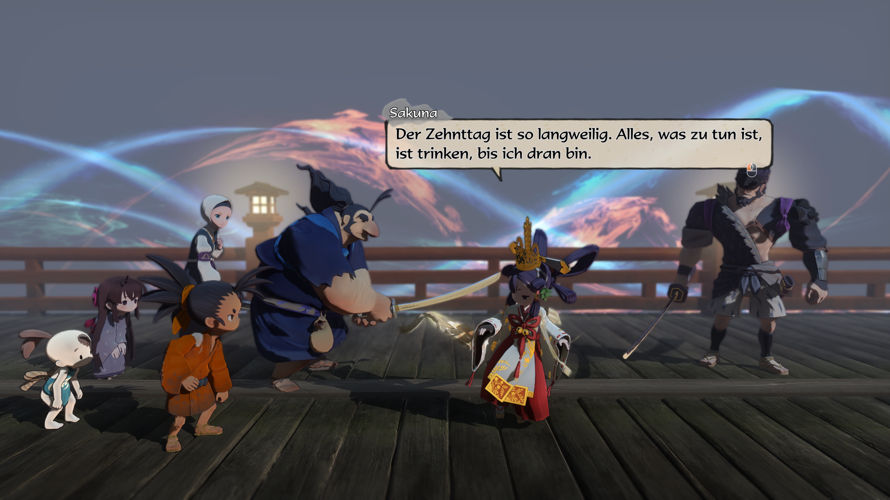

# SakunaDeutsch — German Language Patch for *Sakuna: Of Rice and Ruin*

> [Deutsch](README.de.md)  |  **English**

A complete German translation of *Sakuna: Of Rice and Ruin*. The game has no
official German language – this patch writes German into the existing
**`Spanish` column** and switches the game via **`"Language": "Sp"`**. English
remains untouched.

> **No game data in this repository.** This repo ships *only* the toolchain and
> the German translation tables. The `.arc` archives are **not distributed** –
> the installer builds them from **your own copy of the game** (everyone needs
> a legitimately owned copy).

> **Unofficial.** Not an official product, not affiliated with Edelweiss,
> Marvelous or XSEED Games.

---

## For players

### Requirements

- An installed copy of the game (Steam, GOG; works under Linux/Proton too)
- **Python 3.10+** — on Windows download from
  [python.org](https://www.python.org/downloads/) and make sure to check
  **„Add Python to PATH"** during setup; on Linux e.g. `sudo apt install python3`
- On first run the script auto-installs the small `lz4` package (internet
  needed once); total build time about 1–2 minutes

### Installation — three steps

**Windows:** download the repository (Code → Download ZIP), extract it,
**double-click `INSTALL.bat`**. Confirm (Y).

**Linux / macOS:** extract the repository and run:

```bash
python3 install.py
```

The script does everything by itself:

1. **Finds the game** (searches Steam libraries including Flatpak/Proton;
   not found? see FAQ)
2. **Installs missing Python dependencies** (`lz4` via pip)
3. **Creates backups**: `dataWin/Text.arc.bak-original` and
   `Common.arc.bak-original` — once only, never overwritten afterwards
4. **Builds the patch from your copy** (extract → apply German tables →
   validate → repack)
5. **Installs the finished archives** and sets `"Language": "Sp"` in
   `TaueConfig.json`

Launch the game — texts appear in German.

<!-- Suggested screenshots before release:
     
      -->

### Back to the original

- **Windows:** double-click `RESTORE.bat`
- **Linux/macOS:** `python3 install.py --restore`

The backups are simply copied back; the game is retail again.

### FAQ

| Problem | Solution |
|---|---|
| „Spielinstallation nicht gefunden" / game not found | `python3 install.py --game-dir "path/to/Sakuna Of Rice and Ruin"` — the folder must contain `dataWin/Text.arc`. Or set the `SAKUNA_DIR` environment variable. For GOG installs pass the path manually. |
| `pip`/`lz4` fails | Run `python -m pip install lz4` manually (possibly with `--user` or inside a venv), then restart the script |
| Game still shows Spanish/English | `TaueConfig.json` must contain `"Language": "Sp"` (the script sets this automatically); restart the game |
| Game crashes / broken texts | Run `RESTORE.bat` — back to the original |
| Ran Steam „Verify integrity of game files" | Steam restored the retail archives; simply run `INSTALL.bat` again (backups are untouched) |
| **Game update / Steam beta branch switched** | `install.py` detects changed rows automatically and re-keys the tables via the `de_rebase.py` mask (matching by code + source text). If the mask is missing, the script aborts hard instead of writing wrong German. Brand-new rows stay Spanish/English for now – that is the new translation workload. |
| Linux + Proton | The game still lives in `…/steamapps/common/…` — default paths are detected; otherwise pass `--game-dir` |

---

## Status

| Archive | Content | Coverage |
|---|---|---|
| `Text.arc` | Dialogues, quests, locations, UI text | **5734 of 5773 entries (99.3 %)** – the rest are intentionally empty placeholders (`-`, `?dummy`) |
| `Common.arc` | Parameters, items, equipment, cooking, travel objectives, credits | **all translatable entries (2462)** |

**8196 translated strings** in total, 52 translation tables.
Checksums of the tested builds (SHA-256, first 16 characters):
`Text.arc` = `61e75984e8838cc4`, `Common.arc` = `31fbc34915161d94`
(reproducible by the installer — building from retail is byte-identical).
The **open beta build** is supported as well (rebase mask, tested):
`Text.arc` = `c423cfb687221691`, `Common.arc` = `02a66d95d4b97bbc`; the new
beta rows there are still untranslated (2072 + 33 entries of new workload).

---

## For developers & translators

### Manual build template (exactly what `install.py` runs step by step)

```bash
# 1. extract
python3 sakuna.py extract ".../dataWin/Text.arc"   work/Text
python3 sakuna.py extract ".../dataWin/Common.arc" work/Common

# 2. generate PO files (msgid = original text, msgstr = German)
python3 sakuna.py po-dir work/Text   po
python3 sakuna.py po-dir work/Common poCommon

# 3. apply the German tables
python3 apply_de.py po
python3 apply_de.py poCommon

# 4. write back, validate, pack
python3 sakuna.py unpo-dir po       work/Text   mod/Text
python3 sakuna.py unpo-dir poCommon work/Common mod/Common
python3 sakuna.py validate-dir mod/Text --src English --dst Spanish   # expect 0 errors
python3 sakuna.py pack mod/Text   Text.mod.arc
python3 sakuna.py pack mod/Common Common.mod.arc
```

`msgctxt` is `"<source column>#<row index>"`. An empty `msgstr` leaves the row
unchanged. `apply_de` reports entries without a table entry (that is the
remaining-work list) and exits with code 1 while any are missing – not a
failure of the running transfer.

**Validate `Common` pair by pair**, because not every file has every column
(`NameEn`→`NameSp`, `TextEn`→`Spanish`, the two `Travel` files use
`TextSp` → `--dst TextSp`, …). `validate-dir --src English` reports "source
column missing" for a number of Common files – they simply have no `English`
column (Credits, Soilwork, Hanasaka, all `Travel` files …); these are cosmetic
notes, not translation errors.

### Project layout

| File/Directory | Purpose |
|---|---|
| **`install.py`** | **One-command installer**: path detection, dependencies, backup, build, install, language, `--restore` |
| `INSTALL.bat` / `RESTORE.bat` | Windows double-click wrappers for `install.py` |
| **`make_rebase.py`** | Generates `de_rebase.py` when a game update shifted rows (old↔new match by code + source text) |
| **`de_rebase.py`** | AUTO-generated row mask; only active on beta/update builds, ignored on retail |
| `sakuna.py` | Core tool: ARC read/write (TGP0 + LZ4), CSV↔PO, validation, CLI |
| `apply_de.py` | Injects all registered `de_*.py` tables into the PO files |
| `de_*.py` (52) | Translation tables: `(full path, "English#<row>") -> German text`; `None` = intentionally skipped |
| `po/`, `poCommon/`, `work/`, `mod/`, `*.mod.arc` | local build artifacts – kept out of the repo via `.gitignore` |

### Table format

```python
_PATH = "Text/Event/Mura/Soto/Yui.csvtxt"
_PAIRS = [
    (1, 'First German line'),
    (2, 'Second line\nwith break'),
]
DE = {(_PATH, f"English#{r}"): t for r, t in _PAIRS}
assert len(_PAIRS) == N
assert [r for r, _ in _PAIRS] == list(range(1, N + 1))
```

Contribution rules:

- **Always key by full archive path** when the file name is not unique
  (there are three `Yui` files under `Event/Mura/`).
- **The number of `\n` must exactly match the original** (HUD line breaks);
  checked mechanically against the PO, never by eye.
- **Rows without text stay `None`** (explicitly), not omitted.
- Wording feedback works best as an issue with a screenshot: the text is
  patched into the table and reaches the game with the next `install.py` run.

### Glossary (excerpt)

| Original | German |
|---|---|
| Revered Ears | Verehrte Ähren |
| Lofty / Lowly Realm | Erhabenes / Niedriges Reich |
| Tree of Creation | Baum der Schöpfung |
| floating bridge of heaven | Schwebende Brücke des Himmels |
| Orb of Transformation | Verwandlungskugel |
| Spirit Bough | Geistzweig |
| Fire Resistance / Waterborne / Undead Avenger | Feuerabwehr / Wassergeboren / Rächer der Untoten |
| Amagaeshi Shrine | Amagaeshi-Schrein |
| Demon X / Specter X | Dämonen-X / X-Gespenst |
| Character names (Sakuna, Tauemon, Kinta, Kamuhitsuki, Omizuchi, …) | unchanged |

Character registers are preserved: Tauemon stays formal, Kinta stays rough,
Yui stays terse, Kaimaru's babble ("Sah-Sah!") stays untranslated, Myrthe's
simplified English becomes simplified German.

### Known gotchas (development)

- **`.csvtr` files (travel objectives)** use `\r`-only line endings and come
  in two target-column variants (`Spanish` or `TextSp`) – `DST_ALIASES`
  resolves this; never append columns manually. The `.csvtr` extension must
  stay in `CSV_EXTENSIONS`, otherwise `po-dir` will not generate these POs.
- **Non-English columns** in `Common`: validate pair by pair, not globally.
- **Fonts:** German umlauts are verified on world map / exploration
  objectives; spot-check dialogue boxes visually before a release.
- **Tables are keyed by row index** – after a game update run `validate`
  first.

### Contributing

1. Clone the repo, `pip install -r requirements.txt`
2. Run the pipeline to step 2, fill in the affected PO line **or** fix the
   matching `de_*.py` table
3. `apply_de` → `unpo-dir` → `validate` → `pack` → check in-game
   (or just run `python3 install.py` – same thing, automated)
4. Open a pull request with a screenshot of the checked spot

---

## Credits & license

- **Format/tool knowledge** inspired by
  [Kaplas80/SakunaTools](https://github.com/Kaplas80/SakunaTools) (MIT) –
  this port is an independent Python implementation with selectable
  source/target columns; please keep the MIT license notice.
- **Game, original texts and characters:** © Edelweiss / Marvelous /
  XSEED Games. **No game files are redistributed** – an owned copy of the
  game is required.
- **German translation & tool:** see `LICENSE` and the repository author.

**Code license:** MIT (see `LICENSE`). The German translation strings are
under the same license unless stated otherwise; the original game texts
contained in them remain the property of their respective rights holders and
are subject to the disclaimer above.
